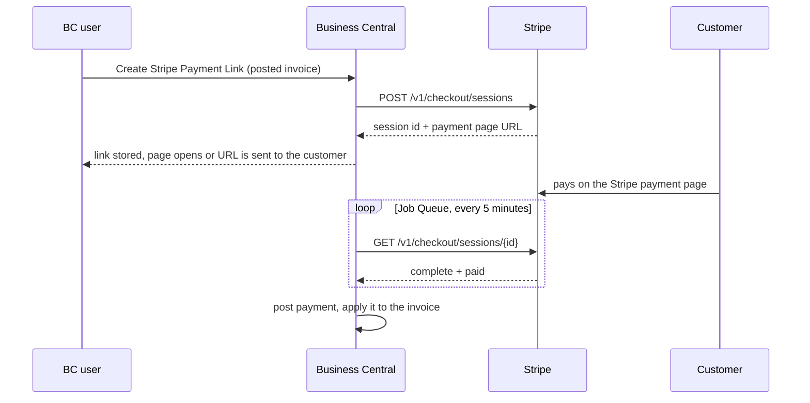
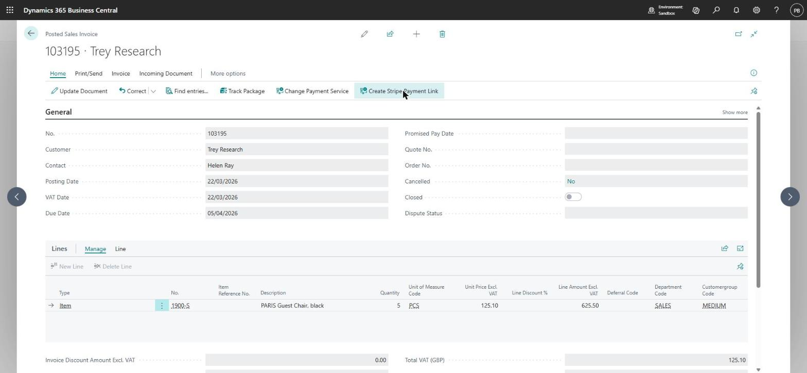
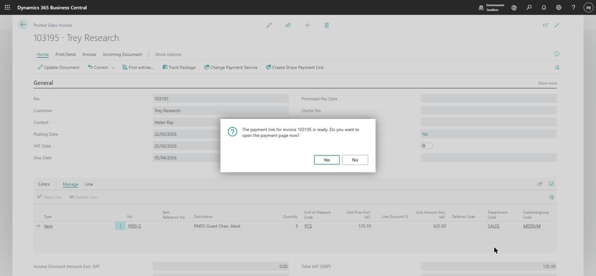
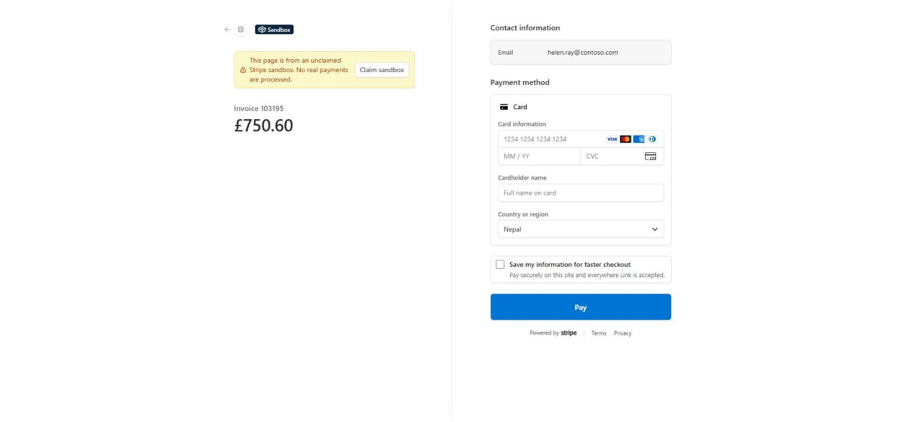
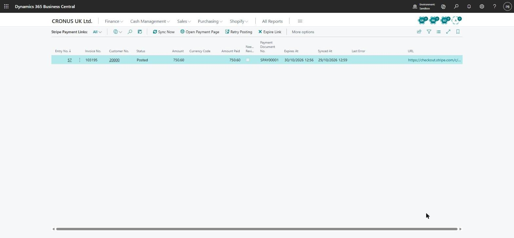
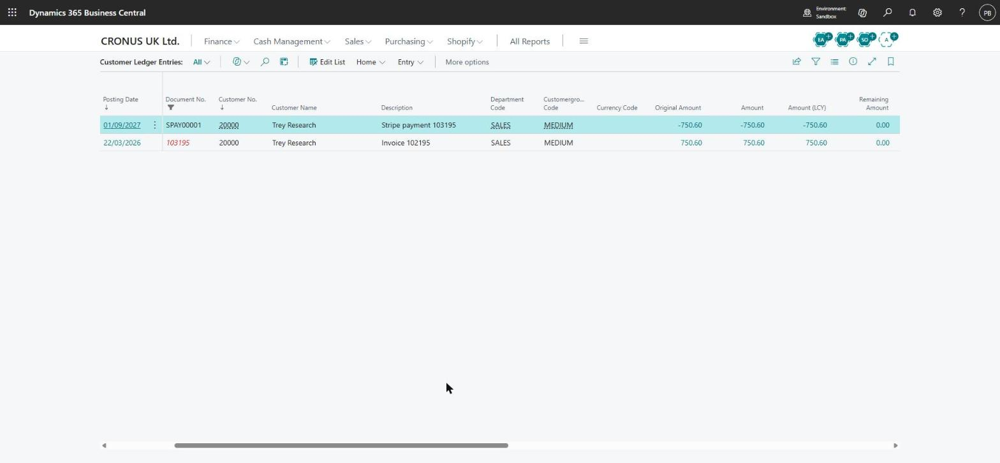
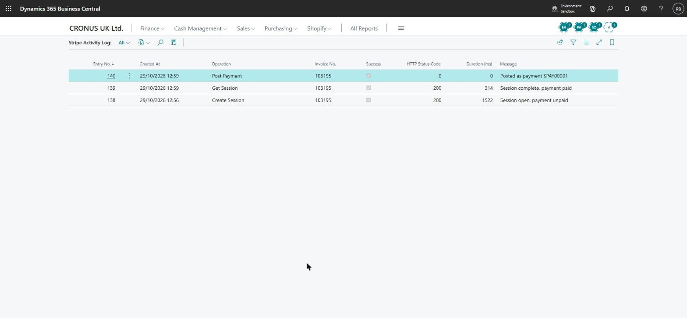

# Stripe Invoice Payments for Business Central

A small Business Central extension that lets a customer pay a posted sales invoice online with Stripe, after which Business Central posts the payment and applies it to the invoice. No middleware, no Azure, and no manual cash receipt journal.

I built it in October 2026 as a portfolio sample of a payment-gateway integration done properly: secrets kept in isolated storage and never in a table field, every external call logged, and money never posted twice. I have built the same pattern in production for two Nepali payment gateways (eSewa and Fonepay). This sample uses Stripe so that anyone can try it with Stripe's test cards.

Business Central 29, AL runtime 18.0, target Cloud, no dependencies. Objects 58150-58189, prefix SIP, permission set and translation file included. 31 automated tests in a separate test app, all passing on a BC 29.0 online sandbox, and run end to end against Stripe's test mode (screenshots below). MIT licence.



## A live run

Invoice 103195 in the CRONUS UK demo company (£750.60), paid in a Stripe test sandbox with the test card 4242 4242 4242 4242, then synced once.

<table>
<tr>
<td width="50%"><br><sub>1. The posted invoice gets a <b>Create Stripe Payment Link</b> action.</sub></td>
<td width="50%"><br><sub>2. Business Central creates the Stripe Checkout Session and offers to open it.</sub></td>
</tr>
<tr>
<td><br><sub>3. The customer sees the invoice number and amount, with their e-mail already filled in. Cards only.</sub></td>
<td><br><sub>4. After the sync the link is Posted: 750.60 paid, payment document SPAY00001.</sub></td>
</tr>
<tr>
<td><br><sub>5. The payment is applied: invoice and payment both have 0.00 remaining. It is posted on the company's work date.</sub></td>
<td><br><sub>6. The activity log: create session, get session, post payment, with HTTP status and duration.</sub></td>
</tr>
</table>

The setup page after the run: [Stripe Setup](docs/screenshots/1-stripe-setup.jpg).

## What it does

1. **Payment link.** On a posted sales invoice, or on an open invoice in Customer Ledger Entries, **Create Stripe Payment Link** creates a Stripe Checkout Session for the remaining amount in the invoice currency. The invoice number travels with the session, and the link is stored in **Stripe Payment Links**.
2. **Sync.** A Job Queue entry (or **Sync Now**) checks every open link with Stripe:
   - Paid: the payment is posted as a customer payment applied to the invoice. Its External Document No. is the Stripe payment intent.
   - Expired: the link is marked Expired, and a new link can be created.
   - Invoice settled in BC while the Stripe page is still open: the page is closed in Stripe, so the customer cannot pay twice.
3. **Review cases.** Anything that should not close the invoice silently is posted and flagged **Needs Review**: a partial payment, a payment discount left open, or an invoice that was already paid another way (the payment is then posted unapplied). A payment in an unexpected currency is not posted: the link is marked Failed with the reason, Retry Posting refuses it, and it is handled in the Stripe Dashboard.
4. **Errors never stop the run.** Each link is processed on its own (`Commit` and `if not Codeunit.Run`). A posting error marks that link **Failed**, keeps the error text, and the other links carry on. **Retry Posting** posts it again once the cause is fixed (for example a blocked customer).
5. **Activity log.** Every Stripe call is logged with its operation, HTTP status, duration and error. The secret key, request bodies and e-mail addresses are never logged.

## How it is built

| Concern | Choice |
|---|---|
| Stripe cannot call a BC online API (BC needs an Entra token) | BC polls Stripe from the Job Queue. A webhook through an Azure Function is the next step for real-time posting. |
| Secret key | Stored in IsolatedStorage as `SecretText`, company scope, never in a table field. `[NonDebuggable]` wherever the key is handled. A key that is not a test key needs confirmation. |
| Double posting | Status checks under an update lock, plus a ledger check on the payment intent before posting. Running sync twice posts once (tested). |
| Money | Amounts are sent in Stripe's minor units, with zero-decimal currencies (JPY, KRW and others) handled. Three-decimal currencies are refused. Fractions of whole-unit currencies are refused, never rounded. |
| Payment methods | Cards only (`allowed_payment_method_types`), so "complete" always means "paid". Delayed methods such as SEPA or ACH would need webhooks. |
| Stripe API version | Pinned per request with `Stripe-Version: 2026-09-30.endive`. |
| Testability | The gateway is an interface behind an extensible enum. The test app adds a mock gateway value, so all business logic is tested without network calls on an ordinary online sandbox. |

## Try it in a sandbox

1. Open `BC-Stripe-Invoice-Payments.code-workspace` in VS Code with the AL extension, let it create a `launch.json` for your Business Central online sandbox (the file is git-ignored), download symbols, and publish the app and then the test app. Or build both with **AL: Package** and install the `.app` files from the Admin Center (Manage Apps).
2. Extension Management > **Stripe Invoice Payments Sample** > Configure > turn on **Allow HttpClient Requests**. Sandboxes block outbound calls until you do this.
3. Get a Stripe test key. Use your own Stripe account (`sk_test_...`), or, if you have none, let the Stripe CLI create a temporary sandbox: `stripe sandbox create --email you@example.com`. Its key starts with `rkcs_test_` and the sandbox lasts 7 days ([Stripe docs](https://docs.stripe.com/cli/sandbox)).
4. Open **Stripe Setup** and fill in:
   - Secret Key
   - Clearing Bank Account No. (the bank account that receives Stripe payments)
   - Payment Nos.
   - Success URL
   - Journal Template Name and Journal Batch Name, only if your General Ledger Setup makes them mandatory

   Then turn on **Enabled** and choose **Test Connection**.
5. Choose **Schedule Sync** to create the Job Queue entry (every 5 minutes).
6. Open a posted sales invoice, choose **Create Stripe Payment Link**, open the page and pay with the test card `4242 4242 4242 4242` (any future date, any CVC).
7. Choose **Sync Now** on **Stripe Payment Links** (or wait for the Job Queue). The link shows Posted and the invoice is closed.

Assign the **SIP STRIPE PAY** permission set to the users who create links or run the sync.

## Objects

| Type | ID | Name |
|---|---|---|
| Table | 58150 | SIP Stripe Setup |
| Table | 58151 | SIP Payment Link |
| Table | 58152 | SIP Activity Log |
| Table | 58153 | SIP Gateway Result (temporary) |
| Enum | 58150 | SIP Payment Link Status |
| Enum | 58151 | SIP Payment Gateway (extensible, implements SIP IPayment Gateway) |
| Interface | | SIP IPayment Gateway |
| Codeunit | 58150 | SIP Payment Link Mgt |
| Codeunit | 58151 | SIP Stripe Gateway |
| Codeunit | 58152 | SIP Stripe Amount |
| Codeunit | 58153 | SIP Payment Sync (Job Queue) |
| Codeunit | 58154 | SIP Check Payment Link |
| Codeunit | 58155 | SIP Post Payment |
| Codeunit | 58156 | SIP Activity Logger |
| Page | 58150 | SIP Stripe Setup |
| Page | 58151 | SIP Payment Links |
| Page | 58152 | SIP Activity Log |
| Page extension | 58150 | SIP Posted Sales Invoice |
| Page extension | 58151 | SIP Customer Ledger Entries |
| Permission set | 58150 | SIP STRIPE PAY |

## Tests

31 tests in the test app (objects 58190-58199). The app depends only on Library Assert, so it runs on a normal online sandbox: publish the test app and run the tests from the VS Code Test Explorer or the AL Test Tool page. Install the test app in sandboxes only, never in production (see the ruleset note below).

| Codeunit | Tests | Covers |
|---|---|---|
| SIP Amount Tests | 5 | Minor units for two-decimal, zero-decimal and three-decimal currencies, UGX, fractions refused |
| SIP Json Tests | 6 | Real Stripe response bodies: create, paid, expired, null fields, error bodies |
| SIP Payment Link Tests | 7 | Link creation, minor units sent, one active link per invoice, closed invoices refused, gateway errors logged, e-mail handling, expiring unknown sessions |
| SIP Payment Sync Tests | 13 | Paid and applied, sync twice posts once, expired, error isolation and retry, paid elsewhere, partial payment, payment discount, wrong currency, invoice settled in BC, link rules after Failed and Expired |

## Limits and next steps

- Cards only. Delayed payment methods need Stripe webhooks, which means an Azure Function in front of a BC API page.
- Stripe fees are not posted. Payouts from Stripe to the real bank account would be a separate bank reconciliation step.
- Refunds are not handled.
- The activity log grows with every sync run. A retention policy is the next addition.

## Repository layout

```
app/    the extension (src/Setup, Gateway, PaymentLink, Sync, Log, Permissions)
test/   the test app (mock gateway, test library, 4 test codeunits)
```

Open `BC-Stripe-Invoice-Payments.code-workspace` in VS Code. Code analysis runs with CodeCop, UICop and PerTenantExtensionCop through `SIP.ruleset.json`. The ruleset turns off PTE0012, which fires on any `internalsVisibleTo`. That setting exists so the test app can reach the internal helpers. It also opens every internal member, including the secret-key accessors, to an app with the test app's identity, which is why the test app belongs in sandboxes only.
